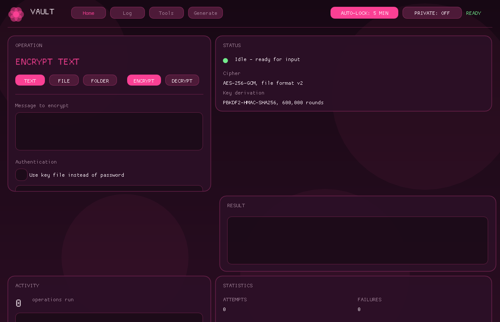

# SecureVault




An open-source desktop app for encrypting text, files, and folders, with secure file shredding and file hashing built in. Written in C++ with a custom [Dear ImGui](https://github.com/ocornut/imgui) interface.

## Features

- **Encrypt and decrypt** text, single files, and whole folders
- **AES-256-GCM** authenticated encryption, so a wrong password or tampered data is detected rather than silently producing garbage
- **PBKDF2-HMAC-SHA256** key derivation (600,000 iterations) with a random salt per file
- **Password or key file**: unlock with a passphrase, or use any file as the key
- **Secure shred**: overwrite files or folders with random data (1 to 5 passes) before deleting
- **File hashing**: SHA-256, SHA-512, SHA-384, SHA-1, MD5
- **Private mode**: masks the password field and hides the activity log
- **Drag and drop**: drop a file or folder on the window and the path box fills in (on the Home tab it also picks the right mode, and decrypt for `.enc` files; on the Tools tab it goes to Inspect or Hash)
- **Browse buttons** open the normal Windows file or folder picker, and paths pasted with quotes (Windows "Copy as path") work as they are
- **Tamper detection**: removed, reordered, duplicated, or appended chunks are rejected, not just flipped bits
- **Password and passphrase generator**: random passwords (choose length and character types) or passphrases from a 2048-word list, with an entropy estimate; a copied password is cleared from the clipboard after 30 seconds
- **Key file generator**: creates a random 64-byte key file and selects it for you
- **Inspect and verify**: see an encrypted file's format and whether it is complete without a password, or check every chunk with one
- **Auto-lock**: clears the password and any text on screen after a chosen idle time (off, 1, 5, 15, or 30 minutes)
- **Command line**: `securevault-cli` does all of this from a terminal, for scripts and automation
- Large files are processed in 64 KB chunks on a background thread, with a live progress bar

## Download

Grab the latest build from the [Releases](../../releases) page.

- **Windows:** download the Windows zip, extract it, and run `securevault.exe` (keep `glfw3.dll` next to it). `securevault-cli.exe` is the command-line version. No installer.
- **Linux:** extract the archive, run `chmod +x securevault securevault-cli`, then run them. Requires GLFW and OpenSSL (`libglfw3`, `libssl3`).

## Using it

1. Pick **TEXT**, **FILE**, or **FOLDER**, then **ENCRYPT** or **DECRYPT**.
2. Enter the text, or type, paste, or **Browse** for the file or folder.
3. Enter a password, or tick *Use key file* and give the path to your key file.
4. Click **START**.

Output naming:

| Operation | Output |
|---|---|
| Encrypt file | `name.ext.enc` next to the original |
| Decrypt file | original name (`.enc` removed), or `name.decrypted` |
| Encrypt folder | `foldername_folder.enc` |
| Decrypt folder | `foldername_restored/` |
| Encrypt text | base64 text shown in the Result box |

The original is never deleted automatically. Use the **Tools** tab to shred it once you've confirmed the encrypted copy works.

The **Tools** tab also has **Inspect / Verify** for encrypted files, and the **Generate** tab makes passwords, passphrases, and key files.

## Command line

```
securevault-cli encrypt  report.pdf                  # asks for a password (hidden input, asked twice)
securevault-cli decrypt  report.pdf.enc
securevault-cli encrypt  photos --keyfile my.key     # a folder, with a key file
securevault-cli verify   report.pdf.enc
securevault-cli inspect  report.pdf.enc              # format and completeness, no password needed
securevault-cli hash     report.pdf --algo sha512
securevault-cli shred    old-notes.txt --passes 3
securevault-cli genkey   my.key
securevault-cli genpass  --length 24                 # or: --words 6
```

Passwords are never accepted as command-line arguments, because they would end up in your shell history and the process list. Use the prompt, `--keyfile FILE`, `--password-env NAME`, or `--password-stdin`. Existing outputs are never overwritten unless you pass `--force`. Exit codes: 0 success, 1 failed, 2 usage error.

## Building from source

Requirements: a C++17 compiler, CMake 3.16+, GLFW 3, and OpenGL. Linux and macOS also need OpenSSL. Windows does not, because it uses the operating system's built-in crypto (CNG).

**Linux (Debian/Ubuntu)**
```
sudo apt install build-essential cmake pkg-config libglfw3-dev libssl-dev libgl1-mesa-dev
mkdir build && cd build
cmake ..
make -j4
./securevault
```

**macOS**
```
brew install glfw openssl cmake
mkdir build && cd build
cmake .. -DOPENSSL_ROOT_DIR=$(brew --prefix openssl)
make -j4
```

**Windows (MSYS2 UCRT64)**
```
pacman -S --needed mingw-w64-ucrt-x86_64-toolchain mingw-w64-ucrt-x86_64-cmake mingw-w64-ucrt-x86_64-glfw
mkdir build && cd build
cmake -G "MinGW Makefiles" ..
cmake --build .
```
The CMake file links the compiler runtime statically on Windows, so the resulting `securevault.exe` runs on machines without MSYS2.

## Project layout

```
src/
  main.cpp                  UI and application state
  theme.hpp                 colors and styling
  vault.hpp / vault.cpp     text, file, folder, hash, and shred logic
  vault_crypto.hpp          crypto interface
  vault_crypto_openssl.cpp  Linux/macOS backend (OpenSSL)
  vault_crypto_win.cpp      Windows backend (CNG / bcrypt)
  pathutil.hpp              path clean-up (quotes, UTF-8)
  filedialog.hpp / .cpp     native file and folder picker
  generator.hpp / .cpp      password, passphrase, and key file generation
  wordlist.hpp              the 2048-word passphrase list
  cli.cpp                   the securevault-cli command line tool
tests/                      crypto and file format tests
THREAT_MODEL.md             what it protects against, and the file format
third_party/imgui/          Dear ImGui
original_python_source.py   the original Python prototype, kept for reference
```

## Technical details

- **File format (v2):** a 25-byte header (`SVLT`, version, chunk size, 16-byte salt) followed by AES-256-GCM chunks. Each chunk is authenticated together with the header and its position, and the last chunk is marked as final, so truncation, reordering, and appended data are detected. Files from v1.0 can still be decrypted. Full details are in [THREAT_MODEL.md](THREAT_MODEL.md).
- **Text format:** base64 of `salt (16) | nonce (12) | ciphertext | tag (16)`.
- **Folders** are packed into a simple custom archive (relative path, size, bytes for each file) and then encrypted like a single file. This is not a ZIP file.

## Limitations

This is a hobby project and has **not been independently audited**. Don't rely on it as the only copy of anything important.

- Secure shredding overwrites the file's contents, but on SSDs, journaling or copy-on-write filesystems, and synced folders (OneDrive, Dropbox), old copies of the data may still exist elsewhere. It is not a guarantee of unrecoverable deletion.
- There is no password recovery. If you lose the password or key file, the data is gone.

## Contributing

Issues and pull requests are welcome.

## License

MIT. See [LICENSE](LICENSE). Dear ImGui is bundled under its own MIT license (`third_party/imgui/LICENSE.txt`). The passphrase word list is the English list from [BIP-39](https://github.com/bitcoin/bips/blob/master/bip-0039/english.txt).
